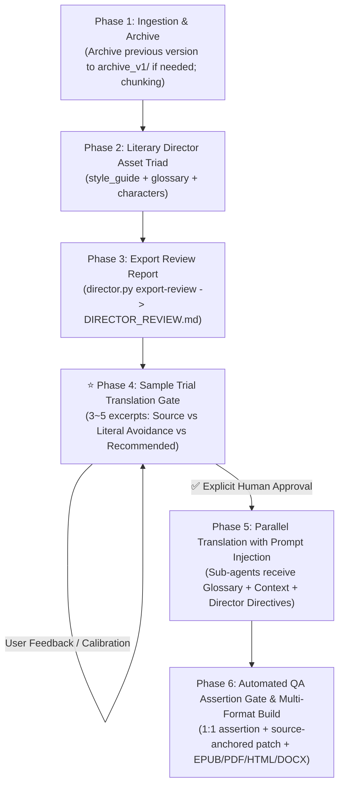

# translate-book: Autonomous Book Translation & Bilingual Publishing System (v1.0.0)

**English** | [简体中文](README.zh-CN.md)

> A production-grade **Agent Skill** tailored for **Claude Code**, **Codex**, **Antigravity**, and **OpenClaw**. Translates full-length books (EPUB / PDF / DOCX / Markdown) into idiomatic bilingual editions through a multi-agent parallel pipeline governed by a **Literary Director**, and compiles publication-ready eBooks across five formats (EPUB, PDF, HTML, DOCX, Markdown).

---

## 🌟 Why translate-book?

Translating full-length literature and complex non-fiction with AI typically suffers from three fundamental bottlenecks:
1. **Loss of Dramatic Voice (Character Flattening)**: Traditional machine translation sounds monotonic—lords, servants, children, and scholars all speak with the same generic translationese.
2. **Register Mismatch & Archaic Cliches**: LLMs frequently inject archaic Chinese storytelling cliches (Ming/Qing dynasty vernacular, feudal servant honorifics) into modern Western literature, or default to lifeless, word-for-word "plastic Chinese" in speculative fiction.
3. **Cross-Chunk Terminology Drift & Context Loss**: Parallel sub-agents lack persistent shared awareness, causing proper nouns, pronoun genders, and world-building concepts to mutate from chapter to chapter.

**translate-book v1.0.0** introduces an industrial-grade **Literary Director System**, **Human-in-the-Loop Sample Trial Translation Gates**, and **Automated 1:1 Assertion Gates (QA)**, delivering authentic literary register and high-value **Audiobook Voice Casting Bibles**.

---

## 🚀 Key Features in v1.0.0

- 🎬 **Literary Director Engine (`scripts/director.py`)**: Pre-production setup establishing the **Style Guide** (`style_guide.json`), **Project Glossary** (`glossary.json`), and **Character Bible** (`characters.json`) with automated prompt injection per chunk.
- 🚫 **Two-Way Register Calibration**:
  - **Anti-Archaic**: Strictly bans feudal subservience (servants say "I", never feudal cliches like "小人/奴才") and martial arts storytelling cliches.
  - **Anti-Translationese**: Mandates the **Ear Test** (reading dialogue aloud in standard Mandarin) to eliminate unnatural Europeanized subordinate clauses and machine-like syntax.
- 🎙️ **Audiobook Voice Casting Profile**: Embeds voice profiles, vocal timbre/pitch, pacing, emotional tone, and real-world actor casting references directly within character entries.
- 🛡️ **Sample Trial Translation Gate (Mandatory Human Sign-off)**: **Strict Rule: Never launch mass translation blindly!** Selects 3–5 representative excerpts contrasting *Original*, *Literal (Avoid)*, and *Recommended Idiomatic* translations. Sub-agents execute only after explicit user approval.
- 🔒 **1:1 Alignment Assertion Gate (QA)**: Rigorous paragraph-by-paragraph assertion testing, zero unaligned dialogue quotation marks, and strict source-anchored patching (`anchor_en` with `assert count == 1`).

---

## 🔄 Standard Workflow (SOP)



### Phase 1: Ingestion & Archive
- If updating an existing book, safely move older artifacts to `archive_v1/`;
- Run `convert.py` to extract images and split into clean Markdown chunks with `manifest.json`.

### Phase 2: Literary Director Asset Setup
Build the three core steering assets using templates in `templates/`:
- `style_guide.json`: Genre, perspective, narrative register, negative constraints, and contrastive case studies.
- `glossary.json`: Canonical names, organizations, places, and ontology terms.
- `characters.json`: Demographics, psychology, dialogue voice, and Audiobook casting profile.

### Phase 3: Export Human-in-the-Loop Review
Generate formatted Markdown reports for editorial review:
```bash
python3 scripts/director.py export-review "<book_dir>" -o "<book_dir>/DIRECTOR_REVIEW.md"
python3 scripts/director.py export-dramatis-personae "<book_dir>" -o "<book_dir>/DRAMATIS_PERSONAE.md"
```

### Phase 4: Sample Trial Translation Gate (Mandatory)
Present 3~5 contrastive test translations (*Source* vs *Literal Avoidance* vs *Recommended Idiomatic*). Wait for explicit human approval before touching full chapters.

### Phase 5: Parallel Translation & Directives Injection
Launch parallel sub-agents (8 concurrent by default). Each chunk dynamically receives:
- Canonical term table (`glossary.py print-terms-for-chunk`)
- Neighboring chunk context (`chunk_context.py`)
- Director's rehearsal notes for appearing characters (`director.py print-directives-for-chunk`)

### Phase 6: QA Assertion Gate & Multi-Format Publishing
Run 1:1 paragraph alignment assertions, sanitize quotes and terminology, then call Pandoc & Calibre to build EPUB, PDF, HTML, DOCX, and Markdown.

---

## 💎 Real-World Showcase: Contrastive Case Studies

Here are authentic side-by-side translation comparisons from production books:

### Showcase A: *His Dark Materials* by Philip Pullman
*Genre: Modern European Philosophical Fantasy / Oxford Academic Epic*

#### Case 1: Lord Asriel Confronts Butler Wren (Aristocratic Authority & Servant Dignity)
- 🇬🇧 **Source**:  
  > *"Good evening, Wren," said Lord Asriel. Lyra always heard that harsh voice with a mixture of pleasure and apprehension. "I arrived too late to dine. I'll wait in here."*  
  > *The Butler looked uncomfortable. ...*  
  > *"Shall I let the Master know you've arrived, my lord?"*  
  > *"No harm in that. You might bring me some coffee."*  
  > *"Very good, my lord."*
- ❌ **Legacy Translation (Archaic feudal servant cliches)**:  
  > “晚上好，伦恩，”阿斯里尔勋爵的声音冷峻威严。……“我来迟了，赶不上正宴，**就在这儿候着吧**。”  
  > 管家面露难色。……  
  > “**需要小人向院长通报您已抵临吗，勋爵阁下？**”  
  > “**去报一声无妨**。顺便给我端壶咖啡来。”  
  > “**遵命，阁下**。”
- ✅ **Director-Guided Translation (Modern British academic & aristocratic register)**:  
  > “晚上好，伦恩，”阿斯里尔勋爵说。莱拉每次听到这沙哑严厉的声音，心中总是既兴奋又害怕。“我来晚了，赶不上正餐。我就在这里等。”  
  > 管家显得有些为难。……  
  > “**需要我通知院长您已经到了吗，勋爵阁下？**”  
  > “**通知一声也无妨。顺便帮我端壶咖啡来。**”  
  > “**好的，阁下。**”
- 💡 **Director's Analysis**: A British college butler carries professional dignity. He says "I", never self-deprecating feudal terms like "小人" (your humble servant/slave).

---

#### Case 2: Lyra and Pantalaimon Arguing in the Wardrobe (Spirited Girl vs Rational Dæmon)
- 🇬🇧 **Source**:  
  > *"You're a coward, Pan."*  
  > *"Certainly I am. May I ask what you intend to do? Are you going to leap out and snatch the glass from his trembling fingers? What did you have in mind?"*  
  > *"I didn't have anything in mind, and well you know it," she snapped quietly. "But now I've seen what the Master did, I haven't got any choice. ... How can I just go and sit in the Library or somewhere and twiddle my thumbs, knowing what's going to happen? I don't intend to do that, I promise you."*
- ❌ **Legacy Translation (Stilted Ming/Qing satirical vernacular)**:  
  > “你就是个胆小鬼，潘。”  
  > “我当然胆小！**敢问阁下到底打算怎么收场？莫非你打算冷不丁跳出去**，从人家颤巍巍的手指间抢走酒杯？**你脑子里究竟有何高见？**”  
  > “**我压根没什么高见**，这点你心知肚明，”她没好气地悄声反诘，“可既然亲眼撞见了院长的**勾当**，我便已别无选择。……难道要我心安理得地坐在图书馆里**闲极无聊转拇指**？我可干不出*那种事*来，我向你保证。”
- ✅ **Director-Guided Translation (Vibrant, sharp, authentic adolescent emotion)**:  
  > “你是个胆小鬼，潘。”  
  > “我当然是。那我倒想请教一下，你到底打算怎么办？难不成直接蹦出去，从他发抖的手里把酒杯夺过来？你心里到底是怎么想的？”  
  > “我什么都没想，你心里一清二楚，”她压低声音没好气地反驳，“可既然撞见了院长的所作所为，我就没得选了。……我怎么可能若无其事地跑去图书馆坐着发呆？我才不会干*那种事*，我向你保证。”
- 💡 **Director's Analysis**: 11-year-old Lyra is wild and sharp-tongued. Terms like "敢问阁下" or "此等勾当" distort her into an archaic caricature.

---

### Showcase B: *The Employees* by Olga Ravn
*Genre: Nordic Posthuman Workplace Sci-Fi / Existential Poetic Fiction*

| English Source | ❌ Literal Translationese (Avoid) | ✅ Recommended Idiomatic Translation | 💡 Director's Analysis & Register Rationale |
| :--- | :--- | :--- | :--- |
| *I'm so tired. It feels like my bones are filled with wet sand.* | 我实在太累了。整副骨头仿佛灌满了潮湿的沙子。 | **我实在太累了，浑身上下跟灌了铅一样。** | English expresses heavy bodily lethargy with "wet sand". Literal "骨头灌满湿沙" feels bizarre in Chinese; native idiom "跟灌了铅一样" captures the crushing exhaustion. |
| *Tell Homebase that I can't rule out that such pride may prompt calls from humanoid employees to be assigned more rights...* | 请转告母星基地，我无法排除这种骄傲会促使仿生人员工发出呼吁，要求被赋予更多权利…… | **请转告母星基地，我不能确定，这样的骄傲会不会促使仿生人员工提出欲求，想要争取更多权利……** | Bureaucratic syntax sounds robotic when translated literally; breaking it into natural clauses balances clinical restraint with underlying tension. |
| *Me, moping about, weeping into my papers?* | 听我无精打采地游荡，对着文件暗自垂泪？ | **看我失魂落魄、趴在文件堆里抹眼泪？** | A modern breakdown at an office desk. "暗自垂泪" sounds like an ancient period drama; "抹眼泪" captures the raw vulnerability of a modern employee. |
| *It's shiny, and as good as a wish.* | 它泛着光泽，美妙得宛若一个许愿。 | **它泛着光，好得就像心愿成真一样。** | Chinese has no valid collocation for "宛若一个许愿". Translating to "心愿成真" accurately conveys deep psychological salvation. |

---

## 🛠️ CLI Toolchain Reference

All tools reside in `scripts/` and rely exclusively on the Python 3 standard library:

| Script | Purpose & Usage |
| :--- | :--- |
| **`director.py`** | **Literary Director & Audiobook Manager**.<br>• `python3 scripts/director.py check <book_dir>`: Validates style guide, glossary, and characters.<br>• `python3 scripts/director.py print-directives-for-chunk <dir> <chunk.md>`: Emits prompt directives for appearing characters.<br>• `python3 scripts/director.py export-review <dir> -o <dir>/DIRECTOR_REVIEW.md`: Exports Markdown review.<br>• `python3 scripts/director.py export-dramatis-personae <dir>`: Exports Dramatis Personae. |
| **`convert.py`** | **eBook Ingestion & Chunking**.<br>`python3 scripts/convert.py "book.epub" --olang zh`<br>Extracts embedded images and outputs `chunk*.md`, `manifest.json`, and `source_fingerprint.json`. |
| **`glossary.py`** | **Terminology Consistency Engine**.<br>`python3 scripts/glossary.py count-frequencies "<temp_dir>"`<br>`python3 scripts/glossary.py print-terms-for-chunk "<temp_dir>" "chunk0001.md"` |
| **`chunk_context.py`** | **Neighbor Excerpt Extraction**.<br>`python3 scripts/chunk_context.py "<temp_dir>" "chunk0001.md"` (Provides ~300 chars of prior/next boundary context). |
| **`run_state.py`** | **Selective Re-translation & Resumption**.<br>`python3 scripts/run_state.py plan "<temp_dir>"`<br>`python3 scripts/run_state.py record "<temp_dir>" chunk0001 ...` |
| **`merge_and_build.py`** | **Unified Format Publisher**.<br>`python3 scripts/merge_and_build.py --temp-dir "<temp_dir>" --title "《Title》" --cleanup`<br>Compiles Markdown into EPUB, PDF, HTML, and DOCX. |

---

## 📦 Quickstart & Installation

### 1. Clone into your Agent Skills directory
```bash
# For Claude Code / Codex / OpenClaw global skills:
git clone git@github.com:orestesza/translate_book_skill.git ~/.agents/skills/translate-book

# Or within your current workspace:
git clone git@github.com:orestesza/translate_book_skill.git ./skills/translate-book
```

### 2. Run Test Suite
```bash
python3 -m unittest discover -s tests -p 'test_*.py' -v
# 250 unit tests run and pass in ~0.4s
```

### 3. Out-of-the-Box Templates
Ready-to-use template schemas are provided in `templates/`:
- `templates/style_guide.template.json`
- `templates/glossary.template.json`
- `templates/characters.template.json`

---

## ⚙️ System Dependencies

- **Python 3.10+** (standard library only)
- **Pandoc** (Markdown AST and document generation)
- **Calibre** (`ebook-convert` CLI for fine-tuned EPUB rendering)
- **WeasyPrint** or **Chromium** (optional, for PDF rendering)

---

## 🙏 Acknowledgements & Origins

This project was originally inspired by and learned from the pioneering open-source skill [`deusyu/translate-book`](https://github.com/deusyu/translate-book) (accessed via `npx skills add deusyu/translate-book`). 

We express our sincere gratitude to **@deusyu** for establishing the foundational eBook chunking and translation pipeline concept. Building upon that foundation, `translate-book v1.0.0` evolved and engineered an industrial-grade system introducing the **Literary Director System**, **Character Voice Casting Profiles**, **Human-in-the-Loop Sample Trial Translation Gate**, **Source-Anchored Alignment Patching**, and comprehensive **QA Assertion Testing**.

---

## 📄 License

Licensed under the [MIT License](LICENSE). Contributions, Issues, and PRs are warmly welcome!
