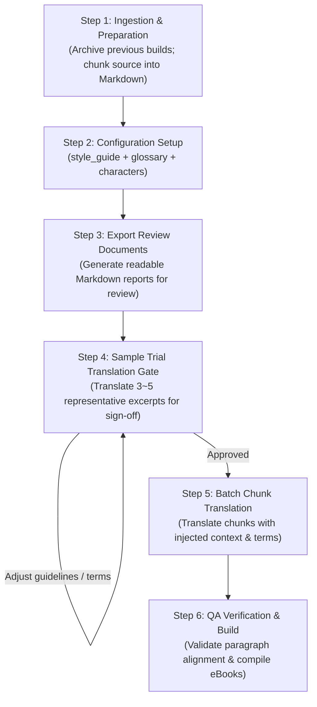

# translate-book: Chunk-based Book Translation & Bilingual Publishing Tool (v1.0.0)

**English** | [简体中文](README.zh-CN.md)

> An Agent Skill for Claude Code, Codex, Antigravity, and similar AI environments. It splits English books (EPUB, PDF, DOCX, Markdown) into manageable chunks for paragraph-level bilingual translation, and compiles the result into EPUB, PDF, HTML, DOCX, and Markdown editions.

---

## Background

Translating full-length books with LLMs typically encounters several common challenges:
1. **Inconsistent or unnatural voice**: Dialogues can easily turn into generic translationese or lose character distinctions;
2. **Stylistic mismatch**: Models sometimes introduce archaic or mismatched cliches into modern literature, or produce rigid, literal translations that read unnaturally in target languages;
3. **Terminology drift across chapters**: When chapters are translated independently across multiple calls or sub-agents, proper names and key concepts frequently vary.

To address these issues, `translate-book` provides a structured workflow with **pre-configured style and character profiles (`director` assets)**, a **mandatory sample trial translation gate**, and **paragraph-level QA assertions**.

---

## Core Features

- **Translation Asset Management (`scripts/director.py`)**: Centralizes the style guide (`style_guide.json`), glossary (`glossary.json`), and character profiles (`characters.json`), automatically injecting relevant constraints into each chunk's prompt.
- **Register & Style Control**:
  - Enforces appropriate forms of address and natural dialogue suited to the original genre;
  - Encourages fluency in target-language phrasing to avoid awkward syntactic calques.
- **Character & Audio Casting Notes**: Records character traits, dialogue styles, and pacing notes, helping maintain consistency across translators and serving as a reference for future audiobook narration.
- **Sample Trial Translation Gate**: Translates 3–5 representative excerpts for human review and sign-off before full-scale batch translation begins.
- **Paragraph Alignment & QA**: Validates 1:1 bilingual paragraph alignment and formatting consistency, supporting source-anchored localized patching.

---

## Standard Workflow



### 1. Ingestion & Preparation
- If updating an existing project, archive older artifacts to `archive_v1/`;
- Run `convert.py` to extract images and split the source eBook into Markdown chunks and a `manifest.json`.

### 2. Configuration Setup
Using the schemas in `templates/`, create the project configuration files:
- `style_guide.json`: Genre, narrative perspective, tone guidelines, and negative constraints;
- `glossary.json`: Standardized translations for character names, locations, and key concepts;
- `characters.json`: Primary characters, dialogue mannerisms, and casting notes.

### 3. Export Review Documents
Generate human-readable summary files for inspection:
```bash
python3 scripts/director.py export-review "<book_dir>" -o "<book_dir>/DIRECTOR_REVIEW.md"
python3 scripts/director.py export-dramatis-personae "<book_dir>" -o "<book_dir>/DRAMATIS_PERSONAE.md"
```

### 4. Sample Trial Translation Gate
Select 3–5 representative excerpts and translate them with contrastive options (literal vs. idiomatic). Review and adjust the style guide before batch processing.

### 5. Batch Chunk Translation
When translating chunks in parallel, the scripts inject:
- Chunk-specific glossary terms (`glossary.py print-terms-for-chunk`)
- Boundary context from adjacent chunks (`chunk_context.py`)
- Dialogue directives for appearing characters (`director.py print-directives-for-chunk`)

### 6. QA Verification & Multi-Format Build
Run paragraph-level alignment checks to confirm parity, then compile the translated Markdown into EPUB, PDF, HTML, and DOCX using Pandoc and Calibre.

---

## Translation Examples & Rationale

Below are examples from actual translation runs illustrating common adjustments:

### Example 1: *His Dark Materials* by Philip Pullman
*Genre: British Fantasy / Academic Setting*

#### Dialogue: Butler Wren and Lord Asriel
- 🇬🇧 **Source**:  
  > *"Good evening, Wren," said Lord Asriel. Lyra always heard that harsh voice with a mixture of pleasure and apprehension. "I arrived too late to dine. I'll wait in here."*  
  > *The Butler looked uncomfortable. ...*  
  > *"Shall I let the Master know you've arrived, my lord?"*  
  > *"No harm in that. You might bring me some coffee."*  
  > *"Very good, my lord."*
- ❌ **Literal / Historical Cliche (Butler uses feudal subservient self-address "小人")**:  
  > “晚上好，伦恩，”阿斯里尔勋爵的声音冷峻威严。……“我来迟了，赶不上正宴，就在这儿候着吧。”  
  > 管家面露难色。……  
  > “需要小人向院长通报您已抵临吗，勋爵阁下？”  
  > “去报一声无妨。顺便给我端壶咖啡来。”  
  > “遵命，阁下。”
- ✅ **Adjusted Translation (Maintains professional tone of a British college butler)**:  
  > “晚上好，伦恩，”阿斯里尔勋爵说。莱拉每次听到这沙哑严厉的声音，心中总是既兴奋又害怕。“我来晚了，赶不上正餐。我就在这里等。”  
  > 管家显得有些为难。……  
  > “需要我通知院长您已经到了吗，勋爵阁下？”  
  > “通知一声也无妨。顺便帮我端壶咖啡来。”  
  > “好的，阁下。”
- 💡 **Note**: A British college butler is a professional employee. He refers to himself naturally as "我" (I), not feudal terms like "小人".

---

#### Dialogue: Lyra and Pantalaimon
- 🇬🇧 **Source**:  
  > *"You're a coward, Pan."*  
  > *"Certainly I am. May I ask what you intend to do? Are you going to leap out and snatch the glass from his trembling fingers? What did you have in mind?"*  
  > *"I didn't have anything in mind, and well you know it," she snapped quietly. "But now I've seen what the Master did, I haven't got any choice. ... How can I just go and sit in the Library or somewhere and twiddle my thumbs, knowing what's going to happen? I don't intend to do that, I promise you."*
- ❌ **Overly Literary / Stilted Phrasing**:  
  > “你就是个胆小鬼，潘。”  
  > “我当然胆小！敢问阁下到底打算怎么收场？莫非你打算冷不丁跳出去，从人家颤巍巍的手指间抢走酒杯？你脑子里究竟有何高见？”  
  > “我压根没什么高见，这点你心知肚明，”她没好气地悄声反诘，“可既然亲眼撞见了院长的勾当，我便已别无选择。……难道要我心安理得地坐在图书馆里闲极无聊转拇指？我可干不出那种事来，我向你保证。”
- ✅ **Adjusted Translation (Direct, conversational language suited to young characters)**:  
  > “你是个胆小鬼，潘。”  
  > “我当然是。那我倒想请教一下，你到底打算怎么办？难不成直接蹦出去，从他发抖的手里把酒杯夺过来？你心里到底是怎么想的？”  
  > “我什么都没想，你心里一清二楚，”她压低声音没好气地反驳，“可既然撞见了院长的所作所为，我就没得选了。……我怎么可能若无其事地跑去图书馆坐着发呆？我才不会干那种事，我向你保证。”
- 💡 **Note**: An 11-year-old character should speak in direct, modern conversational terms rather than stylized idiom heavy phrases.

---

### Example 2: *The Employees* by Olga Ravn
*Genre: Workplace Sci-Fi / Witness Statements*

| Source Text | ❌ Literal Phrasing | ✅ Idiomatic Chinese | 💡 Note |
| :--- | :--- | :--- | :--- |
| *I'm so tired. It feels like my bones are filled with wet sand.* | 我实在太累了。整副骨头仿佛灌满了潮湿的沙子。 | **我实在太累了，浑身上下跟灌了铅一样。** | "Wet sand" signifies heavy fatigue; Chinese idiomatically expresses this as "灌了铅" (filled with lead). |
| *Tell Homebase that I can't rule out that such pride may prompt calls from humanoid employees to be assigned more rights...* | 请转告母星基地，我无法排除这种骄傲会促使仿生人员工发出呼吁，要求被赋予更多权利…… | **请转告母星基地，我不能确定，这样的骄傲会不会促使仿生人员工提出欲求，想要争取更多权利……** | Broken into natural subordinate clauses suited to workplace debriefs. |
| *Me, moping about, weeping into my papers?* | 听我无精打采地游荡，对着文件暗自垂泪？ | **看我失魂落魄、趴在文件堆里抹眼泪？** | In a modern desk workplace setting, "抹眼泪" is more natural than archaic "暗自垂泪". |
| *It's shiny, and as good as a wish.* | 它泛着光泽，美妙得宛若一个许愿。 | **它泛着光，好得就像心愿成真一样。** | Avoids literal calques like "宛若一个许愿" in favor of natural idiom. |

---

---

## 🛠️ CLI Toolchain Reference

All tools reside in `scripts/` and rely exclusively on the Python 3 standard library:

| Script | Purpose & Usage |
| :--- | :--- |
| **`director.py`** | **Literary Director & Audiobook Manager**.<br>• `python3 scripts/director.py check <book_dir>`: Validates style guide, glossary, and characters.<br>• `python3 scripts/director.py print-directives-for-chunk <dir> <chunk.md>`: Emits prompt directives for appearing characters.<br>• `python3 scripts/director.py export-review <dir> -o <dir>/DIRECTOR_REVIEW.md`: Exports Markdown review.<br>• `python3 scripts/director.py export-dramatis-personae <dir>`: Exports Dramatis Personae. |
| **`convert.py`** | **eBook Ingestion & Chunking**.<br>`python3 scripts/convert.py "book.epub" --olang zh`<br>Extracts embedded images and outputs `chunk*.md`, `manifest.json`, and `source_fingerprint.json`. |
| **`glossary.py`** | **Terminology Consistency Engine**.<br>`python3 scripts/glossary.py count-frequencies "<temp_dir>"`<br>`python3 scripts/glossary.py print-terms-for-chunk "<temp_dir>" "chunk0001.md"` |
| **`chunk_context.py`** | **Neighbor Excerpt Extraction**.<br>`python3 scripts/chunk_context.py "<temp_dir>" "chunk0001.md"` (Provides ~300 chars of prior/next boundary context). |
| **`run_state.py`** | **Selective Re-translation & Resumption**.<br>`python3 scripts/run_state.py plan "<temp_dir>"`<br>`python3 scripts/run_state.py record "<temp_dir>" chunk0001 ...` |
| **`merge_and_build.py`** | **Unified Format Publisher**.<br>`python3 scripts/merge_and_build.py --temp-dir "<temp_dir>" --title "《Title》" --cleanup`<br>Compiles Markdown into EPUB, PDF, HTML, and DOCX. |

---

## 📦 Quickstart & Installation

### 1. Clone into your Agent Skills directory
```bash
# For Claude Code / Codex / OpenClaw global skills:
git clone git@github.com:orestesza/translate_book_skill.git ~/.agents/skills/translate-book

# Or within your current workspace:
git clone git@github.com:orestesza/translate_book_skill.git ./skills/translate-book
```

### 2. Run Test Suite
```bash
python3 -m unittest discover -s tests -p 'test_*.py' -v
# 250 unit tests run and pass in ~0.4s
```

### 3. Out-of-the-Box Templates
Ready-to-use template schemas are provided in `templates/`:
- `templates/style_guide.template.json`
- `templates/glossary.template.json`
- `templates/characters.template.json`

---

## ⚙️ System Dependencies

- **Python 3.10+** (standard library only)
- **Pandoc** (Markdown AST and document generation)
- **Calibre** (`ebook-convert` CLI for fine-tuned EPUB rendering)
- **WeasyPrint** or **Chromium** (optional, for PDF rendering)

---

## 🙏 Acknowledgements & Origins

This project was originally inspired by and learned from the pioneering open-source skill [`deusyu/translate-book`](https://github.com/deusyu/translate-book) (accessed via `npx skills add deusyu/translate-book`). 

We express our sincere gratitude to **@deusyu** for establishing the foundational eBook chunking and translation pipeline concept. Building upon that foundation, `translate-book v1.0.0` evolved and engineered an industrial-grade system introducing the **Literary Director System**, **Character Voice Casting Profiles**, **Human-in-the-Loop Sample Trial Translation Gate**, **Source-Anchored Alignment Patching**, and comprehensive **QA Assertion Testing**.

---

## 📄 License

Licensed under the [MIT License](LICENSE). Contributions, Issues, and PRs are warmly welcome!
