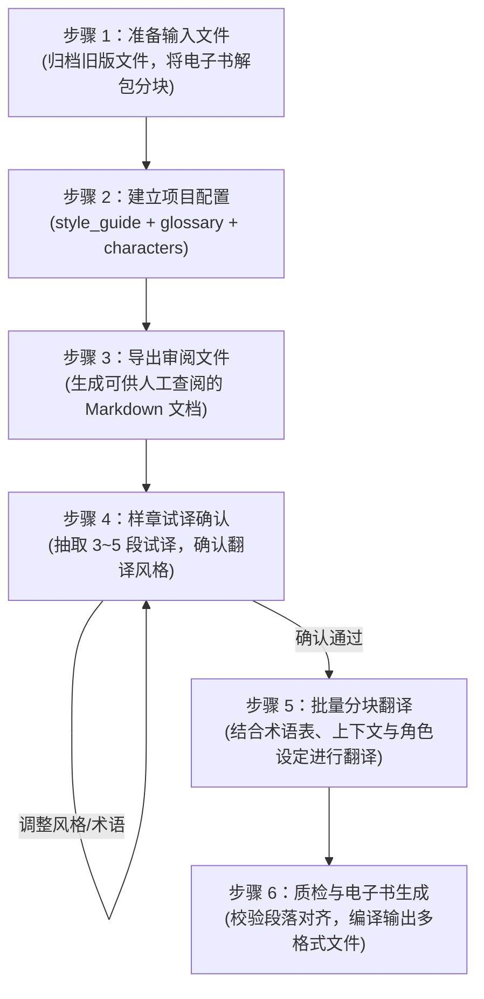

# translate-book: 书籍分块翻译与双语排版工具 (v1.0.0)

[English](README.md) | **简体中文**

> 面向 Claude Code、Codex、Antigravity 等智能体环境的书籍翻译与排版工具。支持将英文书籍（EPUB / PDF / DOCX / Markdown）按章节与段落分块进行双语翻译，并生成 EPUB、PDF、HTML、DOCX 和 Markdown 等格式的双语电子书。

---

## 项目背景

使用大语言模型翻译整本书籍时，常见以下几个问题：
1. **角色语气单一或失真**：对话容易出现翻译腔，或在不同人物间缺乏语气区分；
2. **用词风格不当**：部分模型在翻译西方现代文学时，容易生搬硬套文言或评书词汇（例如仆人自称“小人”），或产生生硬难读的直译句式；
3. **术语不统一与上下文断裂**：多任务并发翻译时，不同章节对同一人名、地名或概念的译法容易前后矛盾。

针对这些问题，本项目在工作流中加入了**风格与人物设定（Director 配置）**、**样章试译确认（Trial Translation Gate）**以及**段落对照质检（QA Gate）**，以保证整本书译文的一致性与可读性。

---

## 核心功能

- **翻译配置管理 (`scripts/director.py`)**：在翻译前集中定义风格指南（`style_guide.json`）、术语表（`glossary.json`）和人物设定（`characters.json`），并在分块翻译时自动提取关联信息注入 Prompt。
- **译文风格控制**：
  - 避免不当的拟古词汇与套话，人物自称和对话贴合原著设定；
  - 强调中文朗读通顺度，减少欧化长句与机械直译。
- **人物与配音备注**：在人物设定中记录人物背景、口吻特征及语调建议，便于译文统一及后续制作有声书时参考。
- **样章试译确认机制**：正式开始全书翻译前，先选取 3~5 个代表性段落进行试译对比，经确认译文风格后再批量执行。
- **段落对照与质检**：提供 1:1 双语段落对照校验，检查标点与格式匹配情况；支持基于英文原文锚点的局部校订。

---

## 工作流程



### 1. 准备输入文件
- 如需保留历史译本，先将旧文件移至 `archive_v1/`；
- 使用 `convert.py` 将原书切分为 Markdown 分块，并生成 `manifest.json` 与图片资源。

### 2. 建立项目配置
参考 `templates/` 中的模板，在书籍目录下创建：
- `style_guide.json`：体裁、叙事视角、行文要求与禁忌词规则；
- `glossary.json`：专有名词、地点与核心术语译法；
- `characters.json`：主要出场人物的身份、口吻及对话要求。

### 3. 导出审阅文件
运行以下命令生成便于人工查阅的配置文档：
```bash
python3 scripts/director.py export-review "<book_dir>" -o "<book_dir>/DIRECTOR_REVIEW.md"
python3 scripts/director.py export-dramatis-personae "<book_dir>" -o "<book_dir>/DRAMATIS_PERSONAE.md"
```

### 4. 样章试译确认
从书中抽取 3~5 个典型段落进行试译，对比原文、直译与地道译法，确认符合预期后再开始后续章节。

### 5. 批量分块翻译
批量翻译各分块时，脚本会自动提取并注入：
- 当前分块涉及的术语（`glossary.py print-terms-for-chunk`）
- 前后分块的邻近上下文（`chunk_context.py`）
- 出场人物的对话指示（`director.py print-directives-for-chunk`）

### 6. 质检与电子书生成
完成翻译后运行对齐校验，确认无漏段、标点匹配无误后，调用 Pandoc / Calibre 编译输出所需格式。

---

## 译文效果对比与案例参考

以下为实际翻译过程中的典型案例对比与处理说明：

### 案例 1：《黑暗物质三部曲》（*His Dark Materials* by Philip Pullman）
*【体裁】英国近代奇幻文学 / 学院背景*

#### 对白处理：管家与勋爵的对话
- 🇬🇧 **英文原文**：  
  > *"Good evening, Wren," said Lord Asriel. Lyra always heard that harsh voice with a mixture of pleasure and apprehension. "I arrived too late to dine. I'll wait in here."*  
  > *The Butler looked uncomfortable. ...*  
  > *"Shall I let the Master know you've arrived, my lord?"*  
  > *"No harm in that. You might bring me some coffee."*  
  > *"Very good, my lord."*
- ❌ **直译/套用演义风格（管家自称“小人”，语气过谦且失真）**：  
  > “晚上好，伦恩，”阿斯里尔勋爵的声音冷峻威严。……“我来迟了，赶不上正宴，就在这儿候着吧。”  
  > 管家面露难色。……  
  > “需要小人向院长通报您已抵临吗，勋爵阁下？”  
  > “去报一声无妨。顺便给我端壶咖啡来。”  
  > “遵命，阁下。”
- ✅ **调整后译文（还原英国近代庄园管家职业语气）**：  
  > “晚上好，伦恩，”阿斯里尔勋爵说。莱拉每次听到这沙哑严厉的声音，心中总是既兴奋又害怕。“我来晚了，赶不上正餐。我就在这里等。”  
  > 管家显得有些为难。……  
  > “需要我通知院长您已经到了吗，勋爵阁下？”  
  > “通知一声也无妨。顺便帮我端壶咖啡来。”  
  > “好的，阁下。”
- 💡 **说明**：英国学院及庄园管家（Butler）属于专业雇员，自称应使用自然的“我”，不宜套用古代汉语中的“小人”或“奴才”。

---

#### 对白处理：少女莱拉与精灵潘特莱蒙
- 🇬🇧 **英文原文**：  
  > *"You're a coward, Pan."*  
  > *"Certainly I am. May I ask what you intend to do? Are you going to leap out and snatch the glass from his trembling fingers? What did you have in mind?"*  
  > *"I didn't have anything in mind, and well you know it," she snapped quietly. "But now I've seen what the Master did, I haven't got any choice. ... How can I just go and sit in the Library or somewhere and twiddle my thumbs, knowing what's going to happen? I don't intend to do that, I promise you."*
- ❌ **套用文白混杂语气（做作且脱离少年口吻）**：  
  > “你就是个胆小鬼，潘。”  
  > “我当然胆小！敢问阁下到底打算怎么收场？莫非你打算冷不丁跳出去，从人家颤巍巍的手指间抢走酒杯？你脑子里究竟有何高见？”  
  > “我压根没什么高见，这点你心知肚明，”她没好气地悄声反诘，“可既然亲眼撞见了院长的勾当，我便已别无选择。……难道要我心安理得地坐在图书馆里闲极无聊转拇指？我可干不出那种事来，我向你保证。”
- ✅ **调整后译文（贴合少年角色的日常情绪与直白表达）**：  
  > “你是个胆小鬼，潘。”  
  > “我当然是。那我倒想请教一下，你到底打算怎么办？难不成直接蹦出去，从他发抖的手里把酒杯夺过来？你心里到底是怎么想的？”  
  > “我什么都没想，你心里一清二楚，”她压低声音没好气地反驳，“可既然撞见了院长的所作所为，我就没得选了。……我怎么可能若无其事地跑去图书馆坐着发呆？我才不会干那种事，我向你保证。”
- 💡 **说明**：十一岁少年角色的对话应当简练自然，避免使用“敢问阁下”、“有何高见”等成语套话。

---

### 案例 2：《职员》（*The Employees* by Olga Ravn）
*【体裁】科幻小说 / 工作汇报形式*

| 原文摘录 | ❌ 机械直译（不推荐） | ✅ 意译优化 | 💡 说明 |
| :--- | :--- | :--- | :--- |
| *I'm so tired. It feels like my bones are filled with wet sand.* | 我实在太累了。整副骨头仿佛灌满了潮湿的沙子。 | **我实在太累了，浑身上下跟灌了铅一样。** | 英文以“wet sand”形容沉重疲惫，中文习惯用“灌了铅”传达类似感受。 |
| *Tell Homebase that I can't rule out that such pride may prompt calls from humanoid employees to be assigned more rights...* | 请转告母星基地，我无法排除这种骄傲会促使仿生人员工发出呼吁，要求被赋予更多权利…… | **请转告母星基地，我不能确定，这样的骄傲会不会促使仿生人员工提出欲求，想要争取更多权利……** | 拆分多重从句，符合工作汇报语境。 |
| *Me, moping about, weeping into my papers?* | 听我无精打采地游荡，对着文件暗自垂泪？ | **看我失魂落魄、趴在文件堆里抹眼泪？** | 现代办公室语境下，“暗自垂泪”偏书面古风，“抹眼泪”更真实贴切。 |
| *It's shiny, and as good as a wish.* | 它泛着光泽，美妙得宛若一个许愿。 | **它泛着光，好得就像心愿成真一样。** | 中文通常不说“像一个许愿”，需调整为符合汉语习惯的表述。 |

---

---

## 🛠️ CLI 核心工具与命令清单

所有核心工具均位于 `scripts/` 目录下，基于 Python 3 标准库构建（无需重型依赖）：

| 脚本工具 | 核心功能与参数说明 |
| :--- | :--- |
| **`director.py`** | **文学总导演与有声书管理中枢**。<br>• `python3 scripts/director.py check <book_dir>`：验证三件套配置合法性<br>• `python3 scripts/director.py print-directives-for-chunk <dir> <chunk.md>`：自动嗅探出场角色并生成 Prompt 注入指令<br>• `python3 scripts/director.py export-review <dir> -o <dir>/DIRECTOR_REVIEW.md`：导出人类审阅报告<br>• `python3 scripts/director.py export-dramatis-personae <dir>`：导出演职人员志 |
| **`convert.py`** | **电子书解包与分块**。<br>`python3 scripts/convert.py "book.epub" --olang zh`<br>自动提取图片，生成 `chunk*.md`、`manifest.json` 与 `source_fingerprint.json`。 |
| **`glossary.py`** | **全局术语表管理**。<br>`python3 scripts/glossary.py count-frequencies "<temp_dir>"`<br>`python3 scripts/glossary.py print-terms-for-chunk "<temp_dir>" "chunk0001.md"`（生成三列 Markdown 注入表格）。 |
| **`chunk_context.py`** | **前后上下文消歧**。<br>`python3 scripts/chunk_context.py "<temp_dir>" "chunk0001.md"`（提取前一块尾部与后一块首部各 300 字符）。 |
| **`run_state.py`** | **增量断点续传与重新翻译规划**。<br>`python3 scripts/run_state.py plan "<temp_dir>"`<br>`python3 scripts/run_state.py record "<temp_dir>" chunk0001 ...` |
| **`merge_and_build.py`** | **全格式出版级构建发布**。<br>`python3 scripts/merge_and_build.py --temp-dir "<temp_dir>" --title "《书名》" --cleanup`<br>一键调用 Pandoc 和 Calibre 编译 EPUB、PDF、HTML、DOCX、Markdown。 |

---

## 📦 快速开始与导入指引

### 1. 安装与导入到本地智能体环境
你可以将本仓库直接克隆或解压至您的全局技能库：
```bash
# 克隆到 Claude Code / Codex / OpenClaw 全局 skills 目录：
git clone git@github.com:orestesza/translate_book_skill.git ~/.agents/skills/translate-book

# 或在当前工作区直接使用：
git clone git@github.com:orestesza/translate_book_skill.git ./skills/translate-book
```

### 2. 运行单元测试
```bash
python3 -m unittest discover -s tests -p 'test_*.py' -v
# 250 个单元测试即刻运行通过（~0.4s）
```

### 3. 开箱即用模板
在 `templates/` 目录下提供了三大核心资产的标准空模板，可直接复制使用：
- `templates/style_guide.template.json`
- `templates/glossary.template.json`
- `templates/characters.template.json`

---

## ⚙️ 系统环境依赖

- **Python 3.10+**（标准库）
- **Pandoc**（用于 Markdown 与多格式 AST 处理）
- **Calibre**（命令行工具 `ebook-convert`，用于高质量 EPUB 生成与 CSS 重构）
- **WeasyPrint** 或 **Chromium**（可选，用于高质量 PDF 渲染）

---

## 🙏 致谢与项目渊源 (Acknowledgements & Origins)

本项目最早受到优秀开源项目 [`deusyu/translate-book`](https://github.com/deusyu/translate-book)（曾通过 `npx skills add deusyu/translate-book` 获取使用）的启发，特此向原作者 **@deusyu** 致以最诚挚的感谢！

在吸取其电子书解包、分块处理与翻译流水线核心思想的基础之上，本项目针对长篇文学大作与严肃非虚构翻译中的“译腔重、口吻扁平、跨块术语漂移、缺少人工标定”等痛点，全新重构并进化出了 **“文学总导演三件套”**、**“有声书角色试音志”**、**“试译准入关卡 (Gate)”**、**“原文锚定补丁”** 与 **“双语1:1断言质检”** 等工程化体系，形成了目前的 `translate-book v1.0.0` 工业级发布标准。

---

## 📄 开源许可

本项目采用 [MIT 许可证](LICENSE) 开源。欢迎 Star、Fork 并提交 Issue / PR 共同完善文学级 AI 翻译工作流！
