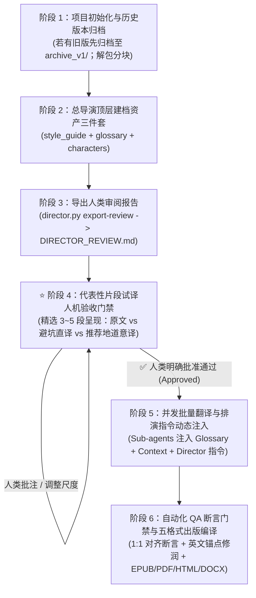

# translate-book: AI 自动化书籍分块翻译与文学双语出版系统 (v1.0.0)

[English](README.md) | **简体中文**

> 面向 **Claude Code**、**Codex**、**Antigravity** 和 **OpenClaw** 的专业级智能体技能（Agent Skill）。支持将英文长篇文学名著、学术专著及报告（EPUB / PDF / DOCX / Markdown）通过多智能体并行流水线进行段落级双语翻译，并一键编译为出版级现代电子书（EPUB、PDF、HTML、DOCX、Markdown）。

---

## 🌟 为什么需要 translate-book？

长文本和整本书籍的 AI 翻译面临三大业界痛点：
1. **千人一面与戏剧感缺失**：传统机器翻译缺乏角色灵魂，老人、幼童、贵族、仆从对话腔调完全一致，充斥着生硬的翻译腔；
2. **风格错位与拟古/评书腔泛滥**：许多大模型在处理西方近代小说时，容易滥用中国明清公案小说、古代演义或茶馆评书的陈词滥调（如管家自称“小人”、动辄“且说/当下/暗忖/势如破竹”）；而在处理现代后人类科幻时，又容易掉入“塑料中文”的生硬直译泥潭；
3. **跨章节术语漂移与上下文断裂**：多 Agent 并发分块翻译时，同一专有名词在不同章节译法不一，代词与性别判断频频出错。

**translate-book v1.0.0** 引入了工业级的**文学总导演（Literary Director）系统**、**试译人机验收门禁**与**自动化断言质检（QA Gate）**，彻底解决了上述问题，打造兼具高保真文学质感与后续**有声书（Audiobook）配音台本**价值的出版级成果。

---

## 🚀 v1.0.0 核心演进特性

- 🎬 **文学总导演中枢 (`scripts/director.py`)**：前置建立《全书风格手册》（`style_guide.json`）、《全局术语表》（`glossary.json`）与《核心人物志》（`characters.json`），向各分块子智能体动态下发排演指示。
- 🚫 **正本清源：现代文学双向避坑准则**：
  - **Anti-Archaic**：严禁明清白话、古代演义与评书套语；严禁封建奴才腔（管家自称“我”，严禁自称“小人/奴才”）；
  - **Anti-Translationese**：坚决破除欧化生硬硬译，所有对白与叙事必须通过**普通话大声朗读耳感检验（Ear Test）**，确保自然地道。
- 🎙️ **前瞻性有声书配音档案 (Audiobook Voice Casting Profile)**：在人物表中不仅规范台词自称与口吻，还为后续制作有声书/广播剧提供音高质感、语速节奏、演播情绪和选角参考演员。
- 🛡️ **代表性片段试译人机验收门禁 (Trial Translation Gate)**：**铁律：严禁未经验收直接盲目全量翻译！** 批量开工前必须先精选 3~5 个代表性片段呈现试译对比，经人类明确批准（Approved）后方可放行。
- 🔒 **源文本严格锚定与 1:1 双语映射断言质检 (QA Gate)**：100% 段落级映射断言，英文无引号严禁注入中文对话引号，严禁数字下标盲修，必须以英文片段严格锚定（`assert count == 1`）。

---

## 🔄 标准工作流程（Standard SOP）



### 1. 阶段 1：项目初始化与历史归档
- 若重修既有项目，将旧产物备份至 `archive_v1/`；
- 调用 `convert.py` 将原著电子书切分为结构化 Markdown 分块与 `manifest.json`。

### 2. 阶段 2：文学总导演顶层建档（资产三件套）
基于内置的 `templates/` 模板，在项目目录构建：
- `style_guide.json`：体裁、叙事视角、叙事笔触、对话原则、负面禁令与直译意译辨析案例；
- `glossary.json`：全书核心专有名词、机构、世界观与本体论设定；
- `characters.json`：人物背景、性格底色、台词自称与有声书配音档案。

### 3. 阶段 3：导出人类审阅报告
运行总导演命令，生成供人类过目审阅的 Markdown 报表：
```bash
python3 scripts/director.py export-review "<book_dir>" -o "<book_dir>/DIRECTOR_REVIEW.md"
python3 scripts/director.py export-dramatis-personae "<book_dir>" -o "<book_dir>/DRAMATIS_PERSONAE.md"
```

### 4. 阶段 4：代表性试译人机验收门禁（强制必选）
从全书中抽取 3~5 段具有代表性的核心段落，呈现实译对比（【原文】vs【生硬直译避坑】vs【推荐地道意译】），向用户请示并获得明确批准。

### 5. 阶段 5：并发批量翻译与动态指令注入
每批启动并行 Sub-agent（默认 8 路并发），每个分块强制注入：
- 全局术语表（`glossary.py print-terms-for-chunk`）
- 邻居上下文（`chunk_context.py`）
- 总导演排演指令（`director.py print-directives-for-chunk`）

### 6. 阶段 6：断言质检与多格式出版编译
运行 1:1 双语断言校验，确认无漏段、无引号异常、无下标偏移后，调用 Pandoc / Calibre 输出全套出版格式。

---

## 💎 实际效果对比与案例展示 (Real-World Showcase)

以下为本项目在实战中真实产出的新旧译文深度对比：

### 案例集 A：《黑暗物质三部曲》（*His Dark Materials* by Philip Pullman）
*【体裁】英国近代欧洲哲学奇幻文学 / 牛津学院派探险史诗*

#### 案例 1：阿斯里尔勋爵进门与管家对峙（上位者威严与仆人自称）
- 🇬🇧 **英文原文**：  
  > *"Good evening, Wren," said Lord Asriel. Lyra always heard that harsh voice with a mixture of pleasure and apprehension. "I arrived too late to dine. I'll wait in here."*  
  > *The Butler looked uncomfortable. ...*  
  > *"Shall I let the Master know you've arrived, my lord?"*  
  > *"No harm in that. You might bring me some coffee."*  
  > *"Very good, my lord."*
- ❌ **旧译（封建重灾区：管家自称“小人”，勋爵似王爷）**：  
  > “晚上好，伦恩，”阿斯里尔勋爵的声音冷峻威严。……“我来迟了，赶不上正宴，**就在这儿候着吧**。”  
  > 管家面露难色。……  
  > “**需要小人向院长通报您已抵临吗，勋爵阁下？**”  
  > “**去报一声无妨**。顺便给我端壶咖啡来。”  
  > “**遵命，阁下**。”
- ✅ **总导演指导新译（现代欧洲贵族探险家与现代英国管家职业对话）**：  
  > “晚上好，伦恩，”阿斯里尔勋爵说。莱拉每次听到这沙哑严厉的声音，心中总是既兴奋又害怕。“我来晚了，赶不上正餐。我就在这里等。”  
  > 管家显得有些为难。……  
  > “**需要我通知院长您已经到了吗，勋爵阁下？**”  
  > “**通知一声也无妨。顺便帮我端壶咖啡来。**”  
  > “**好的，阁下。**”
- 💡 **导演解析**：英国上流社会男管家（Butler）拥有很高的职业尊严，绝非中国旧社会的封建家奴或衙门差役，自称必须为自然的“我”，严禁使用“小人”、“抵临”或“候着”等明清话本词汇。

---

#### 案例 2：莱拉与潘特莱蒙在衣柜中争执（野性少女 vs 理性精灵）
- 🇬🇧 **英文原文**：  
  > *"You're a coward, Pan."*  
  > *"Certainly I am. May I ask what you intend to do? Are you going to leap out and snatch the glass from his trembling fingers? What did you have in mind?"*  
  > *"I didn't have anything in mind, and well you know it," she snapped quietly. "But now I've seen what the Master did, I haven't got any choice. ... How can I just go and sit in the Library or somewhere and twiddle my thumbs, knowing what's going to happen? I don't intend to do that, I promise you."*
- ❌ **旧译（明清白话讽刺，做作如茶馆说书）**：  
  > “你就是个胆小鬼，潘。”  
  > “我当然胆小！**敢问阁下到底打算怎么收场？莫非你打算冷不丁跳出去**，从人家颤巍巍的手指间抢走酒杯？**你脑子里究竟有何高见？**”  
  > “**我压根没什么高见**，这点你心知肚明，”她没好气地悄声反诘，“可既然亲眼撞见了院长的**勾当**，我便已别无选择。……难道要我心安理得地坐在图书馆里**闲极无聊转拇指**？我可干不出*那种事*来，我向你保证。”
- ✅ **总导演指导新译（现代少年真实情绪，直白迅捷，充满灵动张力）**：  
  > “你是个胆小鬼，潘。”  
  > “我当然是。那我倒想请教一下，你到底打算怎么办？难不成直接蹦出去，从他发抖的手里把酒杯夺过来？你心里到底是怎么想的？”  
  > “我什么都没想，你心里一清二楚，”她压低声音没好气地反驳，“可既然撞见了院长的所作所为，我就没得选了。……我怎么可能若无其事地跑去图书馆坐着发呆？我才不会干*那种事*，我向你保证。”
- 💡 **导演解析**：11岁女孩莱拉野性机敏，台词应当短促有力；旧译的“敢问阁下”、“有何高见”、“此等勾当”属于酸腐的文白混杂，新译还原了现代纯正少年文学的鲜活感。

---

### 案例集 B：《职员》（*The Employees* by Olga Ravn）
*【体裁】北欧近未来后人类主义职场科幻 / 存在主义诗性小说*

| 原文摘录 (Source) | ❌ 死板直译（避坑） | ✅ 推荐地道意译 | 💡 导演解析与取舍理由 |
| :--- | :--- | :--- | :--- |
| *I'm so tired. It feels like my bones are filled with wet sand.* | 我实在太累了。整副骨头仿佛灌满了潮湿的沙子。 | **我实在太累了，浑身上下跟灌了铅一样。** | 英语以 wet sand 形容疲倦沉滞，汉语直译“骨头灌满湿沙”极其违和；转化为“跟灌了铅一样”完美再现深空劳役的沉重体感。 |
| *Tell Homebase that I can't rule out that such pride may prompt calls from humanoid employees to be assigned more rights...* | 请转告母星基地，我无法排除这种骄傲会促使仿生人员工发出呼吁，要求被赋予更多权利…… | **请转告母星基地，我不能确定，这样的骄傲会不会促使仿生人员工提出欲求，想要争取更多权利……** | 官僚公文句型直译如同机翻；转化为意合短句，克制中透出对立危机，贴合科研汇报口吻。 |
| *Me, moping about, weeping into my papers?* | 听我无精打采地游荡，对着文件暗自垂泪？ | **看我失魂落魄、趴在文件堆里抹眼泪？** | 办公室伏案崩溃的现代场景，“暗自垂泪”宛如明清宫斗；改作“抹眼泪”还原打工人在审查面前的委屈与恼怒。 |
| *It's shiny, and as good as a wish.* | 它泛着光泽，美妙得宛若一个许愿。 | **它泛着光，好得就像心愿成真一样。** | 汉语没有“一个许愿”的病态搭配；此处指发光物品带来的心理救赎，宛如夙愿成真。 |

---

## 🛠️ CLI 核心工具与命令清单

所有核心工具均位于 `scripts/` 目录下，基于 Python 3 标准库构建（无需重型依赖）：

| 脚本工具 | 核心功能与参数说明 |
| :--- | :--- |
| **`director.py`** | **文学总导演与有声书管理中枢**。<br>• `python3 scripts/director.py check <book_dir>`：验证三件套配置合法性<br>• `python3 scripts/director.py print-directives-for-chunk <dir> <chunk.md>`：自动嗅探出场角色并生成 Prompt 注入指令<br>• `python3 scripts/director.py export-review <dir> -o <dir>/DIRECTOR_REVIEW.md`：导出人类审阅报告<br>• `python3 scripts/director.py export-dramatis-personae <dir>`：导出演职人员志 |
| **`convert.py`** | **电子书解包与分块**。<br>`python3 scripts/convert.py "book.epub" --olang zh`<br>自动提取图片，生成 `chunk*.md`、`manifest.json` 与 `source_fingerprint.json`。 |
| **`glossary.py`** | **全局术语表管理**。<br>`python3 scripts/glossary.py count-frequencies "<temp_dir>"`<br>`python3 scripts/glossary.py print-terms-for-chunk "<temp_dir>" "chunk0001.md"`（生成三列 Markdown 注入表格）。 |
| **`chunk_context.py`** | **前后上下文消歧**。<br>`python3 scripts/chunk_context.py "<temp_dir>" "chunk0001.md"`（提取前一块尾部与后一块首部各 300 字符）。 |
| **`run_state.py`** | **增量断点续传与重新翻译规划**。<br>`python3 scripts/run_state.py plan "<temp_dir>"`<br>`python3 scripts/run_state.py record "<temp_dir>" chunk0001 ...` |
| **`merge_and_build.py`** | **全格式出版级构建发布**。<br>`python3 scripts/merge_and_build.py --temp-dir "<temp_dir>" --title "《书名》" --cleanup`<br>一键调用 Pandoc 和 Calibre 编译 EPUB、PDF、HTML、DOCX、Markdown。 |

---

## 📦 快速开始与导入指引

### 1. 安装与导入到本地智能体环境
你可以将本仓库直接克隆或解压至您的全局技能库：
```bash
# 克隆到 Claude Code / Codex / OpenClaw 全局 skills 目录：
git clone git@github.com:orestesza/translate_book_skill.git ~/.agents/skills/translate-book

# 或在当前工作区直接使用：
git clone git@github.com:orestesza/translate_book_skill.git ./skills/translate-book
```

### 2. 运行单元测试
```bash
python3 -m unittest discover -s tests -p 'test_*.py' -v
# 250 个单元测试即刻运行通过（~0.4s）
```

### 3. 开箱即用模板
在 `templates/` 目录下提供了三大核心资产的标准空模板，可直接复制使用：
- `templates/style_guide.template.json`
- `templates/glossary.template.json`
- `templates/characters.template.json`

---

## ⚙️ 系统环境依赖

- **Python 3.10+**（标准库）
- **Pandoc**（用于 Markdown 与多格式 AST 处理）
- **Calibre**（命令行工具 `ebook-convert`，用于高质量 EPUB 生成与 CSS 重构）
- **WeasyPrint** 或 **Chromium**（可选，用于高质量 PDF 渲染）

---

## 🙏 致谢与项目渊源 (Acknowledgements & Origins)

本项目最早受到优秀开源项目 [`deusyu/translate-book`](https://github.com/deusyu/translate-book)（曾通过 `npx skills add deusyu/translate-book` 获取使用）的启发，特此向原作者 **@deusyu** 致以最诚挚的感谢！

在吸取其电子书解包、分块处理与翻译流水线核心思想的基础之上，本项目针对长篇文学大作与严肃非虚构翻译中的“译腔重、口吻扁平、跨块术语漂移、缺少人工标定”等痛点，全新重构并进化出了 **“文学总导演三件套”**、**“有声书角色试音志”**、**“试译准入关卡 (Gate)”**、**“原文锚定补丁”** 与 **“双语1:1断言质检”** 等工程化体系，形成了目前的 `translate-book v1.0.0` 工业级发布标准。

---

## 📄 开源许可

本项目采用 [MIT 许可证](LICENSE) 开源。欢迎 Star、Fork 并提交 Issue / PR 共同完善文学级 AI 翻译工作流！
